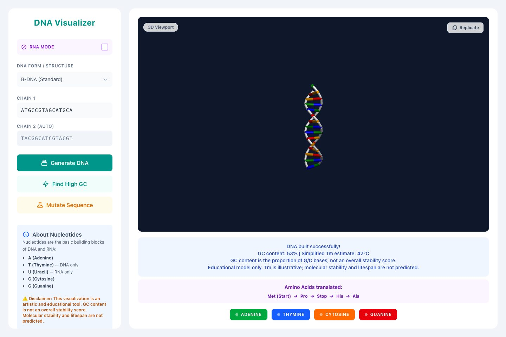

# DNA Visualizer

An educational DNA/RNA visualization built with Three.js. The code and
original documentation were generated with AI.

[Open the demo](https://nikkeyl.github.io/dna/).

## Open locally

Open `index.html` in a browser with WebGL support. There is no installation
or build step. Internet access is required for Three.js, OrbitControls and
Tailwind CSS, which load from CDNs.

## Use

Enter a sequence containing A, T, C and G, then choose **Generate DNA**. The
second chain fills with complementary bases. Switch RNA mode on to use U in
place of T.

Choose A-, B- or Z-DNA to change the illustrated structure. The mutation
control changes one base; **Find High GC** searches 10,000 random samples of
15 bases and displays the sample with the highest GC content. Drag in the 3D
viewport to rotate the model and scroll to zoom.

## What the model means

The helix shapes, RNA representation, amino-acid labels and strand
separation are simplified demonstrations. The app does not simulate a genome
or predict molecular stability or lifespan. GC content describes base
composition; the melting-temperature estimate omits experimental conditions.

The app requires all four base types across paired strands. That is an input
restriction of this implementation. Its high-GC export threshold is not a
measure of biological quality.

Vanilla JavaScript and CDN dependencies keep the page runnable as a local
file, while making it dependent on those external scripts. Sequence handling
and rendering are in `script.js`.

## License

[MIT](LICENSE).
